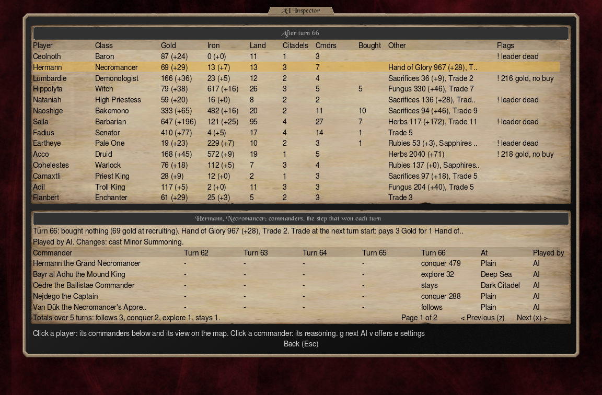
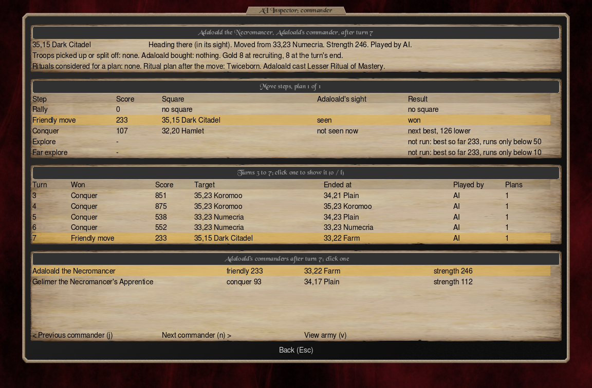
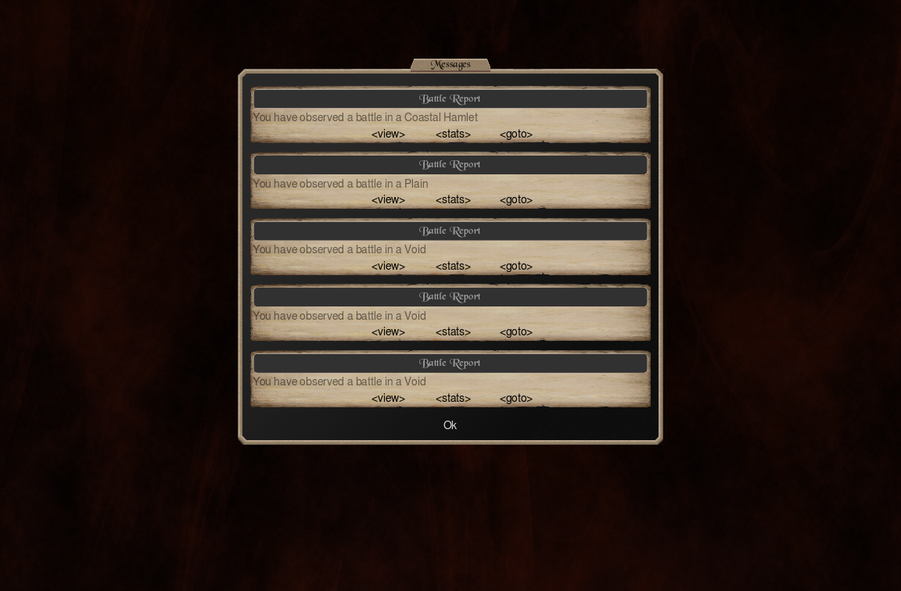

# Jazzy AI Observer

[All mods](../README.md#mods) | [CoE5SE](https://github.com/musical-pianist/coe5se) | [Jazzy Game Presets](../JazzyGamePresets/README.md) | [Jazzy Hotkeys](../JazzyHotkeys/README.md) | [Jazzy Restart](../JazzyRestart/README.md) | [Jazzy UI Tweaks](../JazzyUITweaks/README.md) | [Jazzy Cheats](../JazzyCheats/README.md)

Watch every AI player at once: what each one did last turn and why, its income, its view of the map, and its battles. Then take over one AI and play its turns.  
**Needs [CoE5SE](https://github.com/musical-pianist/coe5se) 2.10.1 or later. Windows only (for now).**

## What It Adds

Start a game with one human player of the *Observer* class and AIs in every other seat. The Observer holds a post and watches. The AIs play as they would without the mod.

### AI Inspector (Enter)

- Every AI on one screen: each resource it holds with its income as the AI is paid, *100 (+45)* like the top bar, its land, citadels and offers, and what changed on its last turn.
- Click a commander for its last turn: the five move steps the AI weighed, with each target square, score and winner, its ritual plan, the troops it gathered and the units it bought.
- Click a square to go there. *View army* opens the game's army view of that commander.
- Right click a square on the map for its AI commanders.

### One AI's view

- The map as one AI sees it: Tab picks the AI, g and F7 step through them, F8 goes back to the Observer's view.
- The top bar shows that AI's income.

### Battle Reports

- Every battle an AI fights lands in the Observer's Messages at turn start, with the game's replay and stats. Read them or close them.

### Skip turns (End)

- 5, 10, or any number from 1 to 50. A key or a click on the map stops it.

### Play as AI

- Pick an AI and play its turns by hand, with every AI bonus. *Play as Observer* (F8) hands it back to the AI.

## Limits

- Windows only for now. Not in network games: CoE5SE runs no scripts there.
- A save made with it needs it on to load.

## For Modders

Jazzy AI Observer is a Lua mod built on CoE5SE's AI sites. The script, JazzyAIObserver.lua, is in the mod's folder to read and learn from. Each AI turn is also written to %APPDATA%\coe5\coe5se_data\JazzyAIObserver\ as .ini files you can read with your own tools.

## Check Out My Other Mods!

- [CoE5SE](https://github.com/musical-pianist/coe5se): loads mods' Lua scripts and adds Mod Settings to the main menu.
- [Jazzy Cheats](../JazzyCheats/README.md): resources, units anywhere you've seen, movement back, and Reveal Map, from the Game Menu.
- [Jazzy Game Presets](../JazzyGamePresets/README.md): save a new-game setup as a preset.
- [Jazzy Hotkeys](../JazzyHotkeys/README.md): change any key of the game's Keyboard Shortcuts list, on every screen.
- [Jazzy Restart](../JazzyRestart/README.md): Restart in the Game Menu. Single player.
- [Jazzy UI Tweaks](../JazzyUITweaks/README.md): small changes to the game's own screens, like deleting saves from Load Game.
